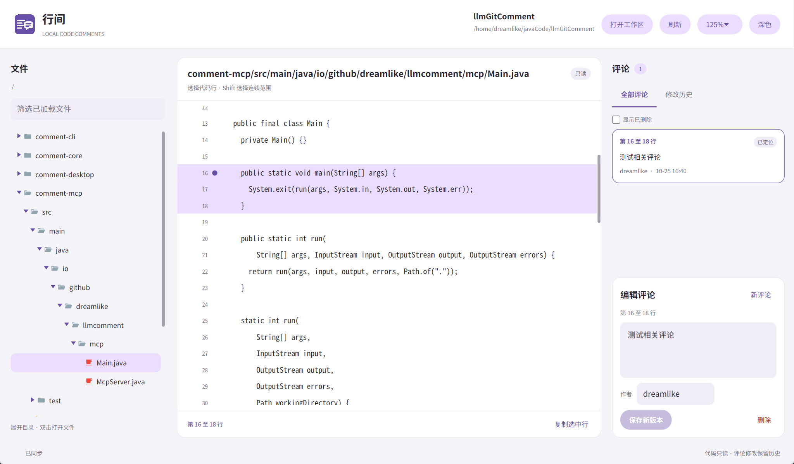
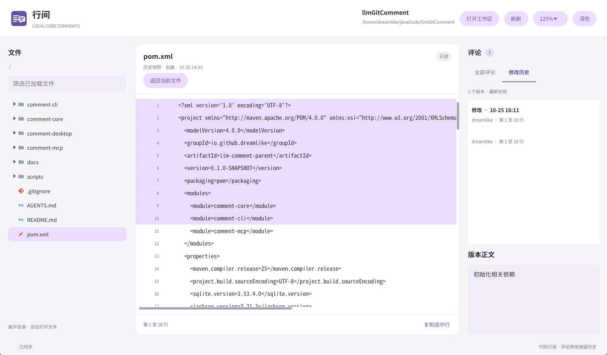
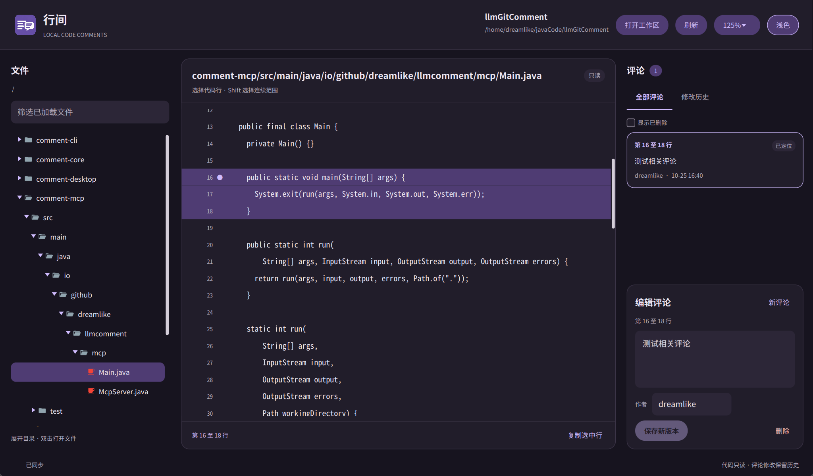

# llm-comment

本地代码评论工具，提供供 LLM 使用的 Java API、CLI、MCP stdio，以及 Material 风格的 JavaFX 桌面端。评论、评论历史和文件快照保存在 SQLite 中。源码按 UTF-8 读取，评论操作保持源码字节不变。工具独立于 Git 和 IDE。

## 界面预览

以下截图来自 Linux `-O3` 原生程序，在本仓库根目录运行 `comment-desktop/target/llm-comment-desktop`，使用本项目的源码和已有评论。

展开目录树浏览源码，选中右侧评论后高亮完整范围。评论圆点显示在起始行。



选择历史版本，同时查看当时的评论正文和源码快照。



切换到深色主题后，目录、源码和评论使用同一套配色。



## 构建与运行

构建需要 Java 25 和 Maven；桌面模块的字体和 JavaFX 兼容资源准备需要 Python 3，首次构建会下载固定 SHA-256 的公开文件，后续复用用户缓存。构建 Native Image 时使用包含 `native-image` 的 GraalVM JDK 25，并准备平台所需的 C 工具链。原生集成检查使用 Python 3。

桌面原生构建当前支持 Linux x64，需要 GCC、objcopy、pkg-config、GTK3/X11/OpenGL 开发库。缺少开发包时，脚本在 Debian/Ubuntu 上自动下载解包到用户缓存，无需 sudo。原生 `verify` 会打开测试窗口，需要可用的 `DISPLAY`；无图形环境可以使用 Xvfb。只构建无头模块时，在下列命令中加 `-pl comment-cli,comment-mcp -am`。

```sh
# JVM 测试及可执行 JAR
mvn verify

# -O0 Native Image，并启动产物执行集成检查
mvn -Pnative-test verify

# -O3 发布产物，并启动产物执行集成检查
mvn -Pnative-release verify
```

JAR 位于 `comment-cli/target/comment-cli-0.1.0-SNAPSHOT.jar` 和 `comment-mcp/target/comment-mcp-0.1.0-SNAPSHOT.jar`。可使用 `java --enable-native-access=ALL-UNNAMED -jar 路径` 启动。

原生可执行文件位于：

- `comment-cli/target/llm-comment`
- `comment-mcp/target/llm-comment-mcp`
- `comment-desktop/target/llm-comment-desktop`

可同时启动两个入口，验证共用数据库时的更新、版本冲突及位置同步：

```sh
python3 scripts/native_smoke.py \
  --cli comment-cli/target/llm-comment \
  --mcp comment-mcp/target/llm-comment-mcp
```

Native Image 使用 `--no-fallback`。SQLite JDBC 的平台 JNI 动态库以资源形式嵌入可执行文件，运行时解压加载，运行环境需要可写的临时目录。SQLite 无需另行安装；该方式仍会加载动态库，并非静态链接 SQLite。

已验证的平台是 Linux x64。其他平台需要在目标平台构建并执行验证。

## 桌面端

```sh
# JVM 构建与启动
mvn -pl comment-desktop -am verify
java --enable-native-access=ALL-UNNAMED \
  -jar comment-desktop/target/comment-desktop-0.1.0-SNAPSHOT.jar

# -O3 原生构建与界面测试
mvn -pl comment-desktop -am -Pnative-release verify
comment-desktop/target/llm-comment-desktop

# 可选：直接打开项目内的文件
comment-desktop/target/llm-comment-desktop \
  --workspace /absolute/project --file src/Main.java
```

桌面端沿用 CLI 的工作区发现规则，也接受 `--database PATH`。界面中可切换工作区；通过“打开工作区”选择的目录使用默认数据库。启动参数均可省略。

- 左侧使用目录树，点击箭头、双击或 Enter 展开目录；双击或 Enter 打开文件。按中英文名称筛选已加载节点，刷新保留展开状态。文件类型图标按文件名和扩展名匹配，目录图标随展开状态变化。
- 中间显示只读源码、行号、选区和评论标记。点击选行，Shift 选择范围，Ctrl/Cmd+C 复制原文。评论只在当前起始行显示圆点；同一起点有多条时显示数量，点击标记选择评论。从右侧选中评论后高亮完整范围。
- 右侧创建、修改、删除评论；每次修改形成历史节点。查看已有评论后重新选行，会自动切换到新增评论；有未保存修改时先确认。历史页同时展示当时的正文与源码。
- “刷新”同步外部代码修改和其他进程的评论。源码已变化的新增选区、已过时的正文版本会提示冲突，并保留草稿。
- 支持浅色、深色主题，Ctrl/Cmd+R 刷新，Ctrl/Cmd+Enter 保存。
- 自动适配高 DPI 屏幕；右上角可选择 75%～300% 缩放，Ctrl/Cmd+加号、减号调整，Ctrl/Cmd+0 恢复自动。窗口变宽时主要扩展源码区域。
- 随应用提供中文、生僻字及 emoji 回退字体；Linux 使用单色 emoji。UTF-8 文件保留原字符、BOM 与换行；非法 UTF-8 会报告编码错误，保留已存快照。
- 各平台通过 JavaFX 公开接口将候选锚点设在输入框下沿；Linux 适配器向 XIM 补充上报该位置。应用图标使用生成的代码行与评论气泡图案，见[图标及生成提示词](docs/app-icon.md)。

需要指定界面大小或直接最大化时：

```sh
comment-desktop/target/llm-comment-desktop --scale 150% --maximized
```

`--scale` 也接受 `1.5`、`auto`，默认 `auto`。手动缩放作用于当前进程，下次启动可通过参数指定。

核心 API、CLI、MCP 和桌面端可以共用同一 SQLite 数据库。桌面端不提供源码编辑、跨文件重命名跟踪或语法高亮；文件变化通过手动刷新或评论操作同步。

界面检查位于 `comment-desktop/checks/`，编译到测试目录，发布 JAR 和可执行文件不包含检查代码。完成构建后，可用独立脚本在临时工作区运行并保存截图：

```sh
python3 scripts/check_desktop.py --smoke-test --screenshot /tmp/llm-comment-desktop.png
# native-release verify 会另行构建独立检查程序
python3 scripts/check_desktop.py --native --smoke-test
```

原生程序运行时无需 JDK，仍依赖 GTK3、X11、OpenGL、Fontconfig 和可写临时目录。中文及 emoji 回退字体嵌入产物，其他文字继续使用系统字体。构建固定使用 Gluon JavaFX 静态 SDK 与 Substrate 元数据，无需 Gluon 账户。发布时需保留 `comment-desktop/target/desktop-native/licenses`。具体版本、兼容处理及验证范围见[桌面端设计与构建](docs/desktop-ui.md)。

检查入口见[桌面检查工具](docs/desktop-checks.md)，十万及百万行的滚动测量见[桌面性能报告](docs/desktop-performance.md)。

## CLI

所有命令共用一套工作区规则：

- 指定 `--workspace PATH` 时直接使用该目录，相对路径以启动目录为基准。
- 省略时，从启动目录向上寻找最近含有 `.llm-comments` 目录的位置；找不到时使用启动目录。
- 数据库默认是工作区中的 `.llm-comments/comments.db`。`--database PATH` 覆盖本次调用的数据库位置。
- `FILE`、`--file`、`--body-file` 和 `--database` 的相对路径都以工作区为基准。源码也可以用工作区内的绝对路径。

`workspace` 命令输出解析后的工作区、数据库路径及数据库是否存在，查询过程不会创建数据库。第一次使用时在项目根目录运行；之后从子目录运行会找到同一个工作区。需要在子目录创建独立工作区时，使用 `--workspace .`。识别工作区依靠 `.llm-comments`，与 Git 或 Maven 文件无关。

```sh
CLI=./comment-cli/target/llm-comment

"$CLI" workspace
"$CLI" create src/Main.java \
  --lines 250:260 --body '这里需要处理空输入' --author reviewer

"$CLI" get COMMENT_ID
"$CLI" list src/Main.java
"$CLI" list --include-deleted

"$CLI" update COMMENT_ID \
  --base-revision REVISION_ID --body '更新后的评论' --author reviewer

"$CLI" history COMMENT_ID
"$CLI" snapshot FILE_VERSION_ID

"$CLI" delete COMMENT_ID \
  --base-revision REVISION_ID --author reviewer

"$CLI" --help
"$CLI" --version

# 从项目外操作时，所有命令都用同一个全局参数指定工作区
"$CLI" --workspace /absolute/project list src/Main.java
```

`create FILE` 和 `list [FILE]` 都接受 `--file FILE` 写法。两种写法同时出现时，规范化后的路径需要相同。`list` 省略文件时查询整个工作区已经记录的评论，与启动时所在的子目录无关。

`--database` 不会保存为配置。使用自定义数据库时，每次 CLI 调用或 MCP 启动都需要提供相同路径；其所在目录不参与工作区自动发现。从项目外或尚无 `.llm-comments` 的子目录访问自定义数据库时，同时指定 `--workspace`。

`--lines N` 选择单行，`--lines N:M` 选择连续多行，首尾行均包含。`--author` 默认是 `anonymous`。更新和删除使用最近一次查询返回的 `currentRevisionId` 作为 `--base-revision`。

创建和更新接受 `--body TEXT` 或 `--body-file PATH`，两者选一个。正文文件路径相对于工作区，也可以使用绝对路径。`--body-file -` 从标准输入读取，保留正文换行：

```sh
"$CLI" create src/Main.java \
  --lines 25 --body-file ./review.txt

printf '第一段\n第二段\n' | "$CLI" update COMMENT_ID \
  --base-revision REVISION_ID --body-file -
```

成功时，标准输出是一条 JSON 对象或数组。`list` 和 `history` 输出数组，其余业务命令输出对象。评论对象包含 `id`、`currentRevisionId`、`body`、`author`、`deleted` 和 `location` 等字段。错误写入标准错误，格式为：

```json
{"code":"CONFLICT","message":"版本冲突","details":{}}
```

`code`、`message` 和 `details` 的内容取决于错误原因。退出码如下：

| 退出码 | 含义 |
| --- | --- |
| 0 | 成功 |
| 1 | 文件读取、数据库或其他运行错误 |
| 2 | 参数、路径或行范围无效 |
| 3 | 评论、快照或文件不存在 |
| 4 | 正文版本冲突，或操作要求评论尚未删除 |

未知参数、重复选项和当前命令不接受的参数会返回错误。

## MCP stdio

MCP 启动时使用相同的工作区发现规则，所有工具调用共用启动时确定的工作区。客户端若从项目根目录启动服务，`args` 可以为空；客户端启动目录不确定时，通过 `--workspace` 指定项目：

```json
{
  "mcpServers": {
    "llm-comment": {
      "command": "/absolute/llmGitComment/comment-mcp/target/llm-comment-mcp",
      "args": ["--workspace", "/absolute/project"]
    }
  }
}
```

服务通过标准输入和标准输出交换逐行 JSON-RPC 2.0 消息，日志写标准错误。客户端先发送 `initialize`，再发送 `notifications/initialized`，随后调用 `tools/list` 和 `tools/call`。服务提供 stdio 工具接口，无需启动 HTTP 服务。

默认协议版本是 `2025-11-25`，也接受 `2025-06-18` 和 `2025-03-26`。前两个版本的工具结果包含对象形式的 `structuredContent`，文本 `content` 中也包含 JSON。`2025-03-26` 使用文本 `content`。业务错误通过 `isError: true` 返回，错误数据包含 `code`、`message` 和 `details`。

| 工具 | 参数 |
| --- | --- |
| `comment_create` | `file`、`startLine`、`body`，可选 `endLine`、`author` |
| `comment_get` | `id` |
| `comment_list` | 可选 `file`、`includeDeleted` |
| `comment_update` | `id`、`baseRevisionId`、`body`，可选 `author` |
| `comment_delete` | `id`、`baseRevisionId`，可选 `author` |
| `comment_history` | `id` |
| `comment_snapshot` | `fileVersionId` |

`endLine` 默认等于 `startLine`，`author` 默认是 `anonymous`。列表默认隐藏删除的评论。MCP 列表结果为 `{"comments": [...]}`，历史结果为 `{"revisions": [...]}`。

## Java API 与模块

根 `pom.xml` 聚合四个模块并集中管理依赖及构建参数。

| 模块 | 内容 |
| --- | --- |
| `comment-core` | Java API、SQLite 存储、文件快照、评论版本和范围定位 |
| `comment-cli` | 调用 core 的命令行入口及 JSON 输出 |
| `comment-mcp` | 调用 core 的 MCP stdio 服务 |
| `comment-desktop` | 调用 core 的 JavaFX 桌面端，含只读源码及评论历史界面 |

core 的数据模型、范围迁移、中文搜索和事务设计见 [comment-core 设计文档](comment-core/DESIGN.md)。
JavaFX 界面结构及 Native Image 构建说明见[桌面端设计](docs/desktop-ui.md)。

`new CommentService()` 使用与 CLI/MCP 相同的工作区发现规则。传入工作区路径的构造方法直接使用该目录，适合需要固定项目位置的调用方：

```java
import io.github.dreamlike.llmcomment.core.CommentService;
import java.nio.file.Path;

try (var service = new CommentService(Path.of("/absolute/project"))) {
    var created = service.create("src/Main.java", 25, 27, "检查空输入", "reviewer");
    var current = service.get(created.id());
    var updated = service.update(current.id(), current.currentRevisionId(),
            "补充边界条件", "reviewer");
    var revisions = service.history(updated.id());
    var snapshot = service.snapshot(revisions.getFirst().location().fileVersionId());
}
```

`CommentService(Path workspace, Path database)` 可指定数据库。API 抛出 `CommentException`，调用方可读取 `code()` 和 `details()`。

图形界面或编辑器集成可用 `inspect(file, includeDeleted)` 一次取得同一版本的源码快照和评论列表。创建评论时可再传入第六个参数 `expectedFileVersionId`，绑定用户看到的快照；保存前源码变化会返回 `FILE_CONFLICT`，避免旧行号落到另一段代码。原五参数 `create` 保持针对操作时源码创建的行为。

## 范围定位与历史

对外行号从 1 开始，起止行均包含。offset 以 Java UTF-16 单元计数，使用半开范围 `[startOffset, endOffset)`。中文通常占一个单元，补充平面字符（例如部分 emoji）占两个单元。

查询评论时，服务读取源码并检查文件快照。同一文件的评论共享上次处理的快照，文件变化后批量更新位置。前置编辑平移范围，内部编辑扩缩范围，首尾插入按非贪婪规则处理。整段替换结合 diff 与文本、上下文校验。使用者按需发起查询即可同步位置，运行服务无需文件监听守护进程。

大文件先按相同的唯一行切分变化区域，再对小块执行字符 diff。长行使用内容切块继续细分。批量原文计数使用共享的数组索引，小文件和少量评论使用 JDK 字符串查找。长原文含重复前缀时使用 KMP，以处理重复中文、代码和 emoji 的搜索。列表按文件共享快照与行索引，行号通过二分查找计算。

| 状态 | 含义 |
| --- | --- |
| `ACTIVE` | 范围可定位，所选文本仍匹配 |
| `MODIFIED` | 范围可定位，范围内文本发生变化 |
| `ORPHANED` | 无法确认范围位置 |
| `AMBIGUOUS` | 存在多个候选位置，无法确认唯一位置 |
| `MISSING_FILE` | 源文件缺失 |

失效状态的 offset 和行号为 `null`。评论及已保存快照继续保留，文本或文件恢复后会再次尝试定位。每次输出的 `location.fileVersionId` 指向用于该位置的明确快照。读取失败会返回错误，并保留数据库中的旧状态。

`commentId` 在评论生命周期内稳定。创建、修改和删除追加不可变 `revisionId`，记录父版本、作者、时间、正文、当时的文件快照和范围。自动位置变化不会增加正文版本。删除追加删除版本，历史和快照仍可查询。历史按追加顺序返回。

`history` 和 `snapshot` 直接读取数据库中的历史记录，当前源码缺失或无法读取时仍然可用。

SQLite 使用 WAL。一次读取状态、同步定位、追加版本和更新当前指针在 `BEGIN IMMEDIATE` 事务中完成，以协调多个进程。更新与删除检查 `baseRevisionId`，旧版本会返回冲突。SQLite 锁覆盖数据库操作，源码可能同时被外部程序编辑，调用方应以返回的快照判断位置对应的内容。

`history` 和 `snapshot` 使用只读事务。未发生变化的源码查询会重新读取文件并比较内容，数据库保持不变。同一事务内处理完一个文件便释放其全文缓存，下一次操作重新校验源码。

## 性能基准

性能测试脚本及测量结果见 [性能报告](docs/performance.md)。可对当前 JAR 执行独立 JVM 基准：

```sh
python3 scripts/benchmark.py \
  --jar comment-cli/target/comment-cli-0.1.0-SNAPSHOT.jar \
  --output target/performance/current.json
```

`--baseline-jar` 可指定优化前的 JAR，使用相同数据和参数比较两个版本。`scripts/native_benchmark.py` 测量两个 MCP Native Image 程序的协议往返耗时。

## 使用限制

- 文件移动或重命名后，需要使用者处理路径变化；工具没有跨文件自动跟踪。
- 重复文本可能导致定位歧义。删除重复副本时会保守返回 `AMBIGUOUS`，恢复定位要求匹配完整上下文。
- 空范围失效后，无法通过搜索空字符串恢复位置。
- 大范围改写会逐块限制字符 diff 的计算量，无法细分的区域通过原文和上下文重新定位；缺乏匹配依据时返回失效状态。文件前置或后置的单纯插入、删除仍按 offset 精确迁移。
- 所有历史版本及其引用的文件快照持久保留。频繁修改大型文件会增加数据库占用。
- 源码需要使用 UTF-8 编码。工具按查询同步文件变化，查询结果对应本次读取的快照。

## 参考资料

- IntelliJ IDEA [RangeMarker](https://github.com/JetBrains/intellij-community/blob/master/platform/core-api/src/com/intellij/openapi/editor/RangeMarker.java)
- IntelliJ IDEA [LineBookmarkProvider](https://github.com/JetBrains/intellij-community/blob/master/platform/bookmarks/src/com/intellij/ide/bookmark/providers/LineBookmarkProvider.kt)
- [MCP 官方协议规范](https://modelcontextprotocol.io/specification/2025-11-25)
- [Xerial SQLite JDBC](https://github.com/xerial/sqlite-jdbc)
