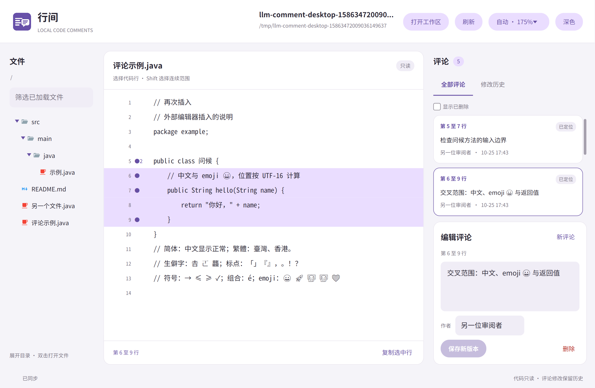

# 桌面端设计与构建

`comment-desktop` 使用 JavaFX 标准控件和 Material 风格 CSS，直接调用 `comment-core`。界面包含目录浏览、只读源码、当前评论和修改历史。UI 与 CLI、MCP 共用工作区、快照、范围迁移和 SQLite 事务。

## 界面与状态

界面分三栏：左侧逐层加载目录并过滤文件名，中间显示源码和行选区，右侧编辑评论或查看历史。浅色与深色主题共用 CSS 颜色变量，按钮、评论卡片、输入框采用统一圆角与间距。当前未引入 MaterialFX、FXML 或 WebView。

`WorkspaceModel` 封装 core API 和目录访问，不依赖 JavaFX。目录一次只加载一层，过滤 `.git`、`.idea`、`target`、`.llm-comments`、当前数据库及其辅助文件，不跟随目录符号链接。文件符号链接的实际目标需要在工作区内。

`FileTreeView` 使用标准 `TreeView`，展开目录时通过后台执行器加载直接子节点。点击箭头、双击目录及 Enter 均可展开或折叠；文件通过双击或 Enter 打开。筛选检查已加载节点并保留匹配节点的祖先，尚未加载的目录仍可展开。刷新重读根目录及展开中的目录，按路径复用节点以保留展开状态。加载结果同时校验工作区代次和节点请求序号。筛选与刷新遍历使用显式队列。

文件图标按完整文件名、扩展名、通用类型依次匹配，例如 `pom.xml` 使用 Maven 标记，其他 XML 使用尖括号。目录根据展开状态切换图形。图标使用固定版本 Material Icon Theme 的 SVG，保留其填色、渐变和 MIT 许可证，尺寸随单元格字号和场景缩放，详见[文件图标实现](file-icons.md)。

`SourceView` 使用虚拟化 `ListView`，行高由每行 `Label`/`HBox` 的首选高度及 CSS 上下留白计算。字号、字体或样式变化会重新布局，空行也保留当前源码字体的行盒。行间距、行号槽和标记槽使用 `em` 随字号变化。该方式需要测量可见行，并估算未显示行的高度，换取中文及不同字形的自适应布局。

JVM 与原生构建共用官方 OpenJFX 21.0.8 `VirtualFlow` 源码。Gluon 静态 SDK 内的旧实现会在调整每个单元时反复扫描行高缓存，百万行滚动因此退化；共用实现按行高缓存的实际变化重算。源码包固定 SHA-256，原始源码和许可证随构建保存，见[性能报告](desktop-performance.md)。

`SourceLines` 保存 UTF-16 offset 与原始换行，支持中文、emoji、LF、CRLF、CR、空文件及末尾空行。点击和 Shift 选择形成连续行范围，复制保留范围内原始换行。超过 10,000 个 UTF-16 单元的单行限制显示长度，并提示可复制全文；截断不改变真实选区或复制内容。

用户点击或使用键盘调整源码选区时，右侧切换到“全部评论”及新增评论编辑器。已有评论尚有修改时先确认放弃，取消会恢复该评论的选区；已经在写新评论时，调整选区会保留草稿。程序因查看评论或历史而高亮源码，不触发新增评论。

`CommentStartIndex` 用哈希表按当前起始行聚合评论。构建和存储为 `O(n)`，每行查询平均为 `O(1)`，返回该行已有的不可变列表；不再遍历区间树或展开评论范围。第 1 至 10 行的评论只在第 1 行显示圆点，同一起始行有多条评论时显示数量并通过菜单逐条选择。打开文件时不自动高亮；侧栏或标记选中评论后，高亮完整的闭区间。外部编辑同步位置后，索引随新快照重建，圆点移到新的起始行。相同范围、包含和交叉范围仍使用各自的评论 ID 及版本链。

窗口图标与页头使用同一张 PNG，窗口提供 16、32、48、64、128、256 像素尺寸供桌面环境选择。[图标生成记录](app-icon.md) 保存了原始提示词。

`DesktopApplication` 在 JavaFX 线程处理界面状态，通过单个后台执行器读取文件、执行 diff 和数据库操作。任务运行期间禁用可能冲突的操作，回调校验请求序号，窗口退出后不再回写 UI。切换文件或工作区、切换评论、关闭窗口时检查未保存的正文及作者变更。

## 高 DPI 与窗口布局

默认使用自动缩放。`UiScale` 先检查 JavaFX 报告的输出缩放，系统已应用大于 1 的比例时不再额外补偿；否则按 `Screen.getDpi() / 96` 计算，取最近的 25% 档位，自动比例限制为 100%～250%。例如本机 4K 屏幕报告 163 DPI、输出缩放为 1，应用采用 175%。显示器上报的物理尺寸可能不准确，因此提供右上角菜单及 `--scale auto|150%|1.5` 覆盖。

`ScaledPane` 用 JavaFX `Scale` 变换整个工作区，布局宽高按视口尺寸除以缩放比例计算。字体、行高、间距与鼠标命中使用相同的坐标变换。源码选择继续存储逻辑行号。最小逻辑界面为 1050×720，较小视口通过外层滚动访问完整界面；正常尺寸预留像素取整余量，防止浮点误差产生多余滚动条。

正文和源码字号为 16px，按钮和评论预览为 14px，辅助信息通常为 12px，整体再随界面缩放。目录栏和评论栏使用固定调整策略及宽度上下限，用户仍可拖动分隔条；最大化时新增空间分配给源码区域。Ctrl/Cmd+加号、减号调整比例，Ctrl/Cmd+0 恢复自动。手动比例作用于当前进程。

## UTF-8、字体与排版

core 按 UTF-8 解码源码，保存原始字符串；UTF-16 offset 用于 Java 内部范围定位。简繁体、补充平面汉字、emoji、组合字符、BOM 和 CRLF 不做归一化或替换。遇到非法 UTF-8 时返回 `FILE_READ_ERROR`，消息明确提示转换编码，事务回滚并保留旧快照及评论历史。程序不会猜测 GBK 等旧编码。

桌面端另需处理字形与排版。DejaVu Sans Mono 缺少汉字，依赖系统回退会出现字体混用或生僻字方框。Linux JavaFX 21 的 FreeType 管线不绘制 Noto Color Emoji 的位图字形，某些 emoji 虽能找到 glyph，光栅结果仍为空。

`scripts/prepare_desktop_fonts.py` 准备三种随应用分发的字体：

| 字体 | 用途 |
| --- | --- |
| Noto Sans Mono CJK SC | 源码主字体和简繁体、全角标点回退 |
| HanaMinB | 补充平面汉字，例如 `𠀀` |
| Noto Emoji | 可由 JavaFX 21 绘制的轮廓 emoji，显示为单色 |

文件来源及 SHA-256 固定，字体和许可证生成到 `target`，缓存位于用户目录的 `llm-comments/desktop-fonts-v1`。三个字体总计约 47 MiB，嵌入 JAR 和 Native Image；下载文件不进入 Git。首次桌面构建需要联网和 Python 3，之后校验并复用缓存。

`DesktopFonts` 在首次布局前将字体释放到可写临时目录并加载。Linux 上通过 Java 25 FFM 调用 Fontconfig，给当前进程排除不支持的 Noto Color Emoji。`EmbeddedFontFallbacks` 向 JavaFX 回退表加入内置字体，保留其他系统回退；适配器与 FontConfigManager 同包，兼容 Gluon 静态 SDK 中该类的包访问权限。该操作不写系统配置。Native Image 元数据声明所需的三个 downcall 签名。字体覆盖仍有边界，不能保证所有 Unicode 版本中的字符及 emoji 序列都能显示。

Linux Pango 兼容处理由 `scripts/prepare_desktop_javafx.py` 从固定版本的 OpenJFX 源码生成，修正三处排版行为：

- 空字形 `PANGO_GLYPH_EMPTY` 映射为 JavaFX 的不可见字形，使 `❤️` 的变体选择符按零宽度显示。
- Pango 字符索引转换为 UTF-16 offset，让复杂 emoji 后的光标命中正确字符。
- 换行拆分改变 TextRun 范围后重建 UTF-8 缓存，对当前范围重新排版。

兼容类优先于依赖中的同名类加载，JVM 使用可执行 JAR 的 classpath 方式运行。输入文本中的变体选择符、ZWJ 和代理对保持原样。

这部分使用 JavaFX 内部接口，与本文列出的版本一起验证。生成资源保留上游许可证、原始源码、修改后的源码及补丁说明；升级 JavaFX 时必须重新核对补丁和实际排版回归，不能只验证编译通过。

## Linux 中文输入法

`DesktopInputMethods` 在 JavaFX Toolkit 启动后、首个窗口创建前，通过 FFM 调用 `libX11.so.6` 的 `XSetLocaleModifiers("")`，让 Xlib 采用已有的 `XMODIFIERS`。JavaFX Glass 21 的 [Linux 输入法实现](https://github.com/openjdk/jfx21u/blob/master/modules/javafx.graphics/src/main/native-glass/gtk/glass_window_ime.cpp) 直接打开 XIM，设置 `GTK_IM_MODULE` 本身不足以完成 Xlib 的初始化。调用约定见 [Xlib 文档](https://xorg.freedesktop.org/archive/current/doc/libX11/libX11/libX11.html)。Native Image 元数据另注册 `void* (void*)` downcall 签名。

初始化使用当前进程的输入法环境。失败时向标准错误输出原因，窗口仍可用于浏览。`TextArea` 使用 JavaFX 的 `InputMethodEvent` 接收组合和提交文本。独立检查会打开临时窗口，用 JavaFX Robot 发送 `nihao` 和空格，同时断言编辑器内容与输入法提交事件都为“你好”：

各平台通过 `InputMethodPlacement` 包装 JavaFX 公开的 `InputMethodRequests`：`getTextLocation` 返回当前输入框底边左侧的 `localToScreen` 坐标，其余操作委托控件 skin。切换焦点时移除旧监听并恢复接口，skin 重新设置接口时重新包装。该规则跟随控件布局与场景缩放，没有特定屏幕尺寸或输入法型号的补偿值。

Linux Glass 未查询该候选锚点，`LinuxImePosition` 消费同一接口并补充 XIM 上报：Glass Screen 将逻辑屏幕坐标转为物理像素，`XTranslateCoordinates` 转为客户窗口坐标，`XSetICValues` 设置 `XNSpotLocation`。输入框及窗口变化触发更新，同一轮事件中的更新合并执行。Windows/macOS 的 Glass 已有公开接口调用路径；这两个平台仍需实机验证，系统候选窗口的边距、外观及屏幕边缘避让由平台决定。

当前 Glass 没有公开获取 XIC 的接口。适配器限定 Linux x64、Maven JavaFX `21.0.8+2` 和 Gluon SDK 内的 `21-internal+11.2-2024-03-05-115411` 两个精确运行时版本，通过 GDK 登记的 `glass_window_context` 验证窗口身份，再按已核对的 C++ 布局读取 XIC。未知版本会停用此适配并记录原因；升级 JavaFX 时需要重新检查本地布局、FFM 元数据及实际候选窗口。该处理没有修改系统输入法配置。

```sh
# 需要已运行的 fcitx5 拼音及 xwininfo
python3 scripts/check_desktop.py --native --ime-test 1
python3 scripts/check_desktop.py --native --ime-test 1.75 /tmp/ime-position.png
```

该检查会激活测试窗口的 fcitx5 输入上下文，窗口失去焦点时停止发送按键。`xwininfo` 读取系统候选窗口的坐标和可见状态，分别检查正文、移动窗口、动态缩放及切换作者输入框后的摆放位置。可选截图来自临时测试窗口所在的屏幕区域，包含系统候选框。坐标断言目前要求 X11 输出比例为 1，应用缩放由 `ScaledPane` 提供。此检查需要桌面输入法服务，独立于可在 Xvfb 上运行的常规界面测试。

## Google 官方 Material 与 JavaFX

2026-10-25 核查的 Google 官方 Material 开发资料没有提供 JavaFX 控件库。现有官方实现包括 [Android Compose Material 3](https://developer.android.com/develop/ui/compose/designsystems/material3)、[Flutter Material](https://docs.flutter.dev/ui/widgets/material) 和 [Material Web](https://github.com/material-components/material-web)。[MaterialFX](https://github.com/palexdev/MaterialFX) 与 [JFoenix](https://github.com/sshahine/JFoenix) 是第三方 JavaFX 项目。

本项目的实现是 JavaFX 标准控件配合 Material 风格 CSS，覆盖配色、圆角、排版和控件状态。Google 官方 [material-color-utilities](https://github.com/material-foundation/material-color-utilities) 提供 Apache 2.0 许可的 Java 配色算法源码，可以用于生成颜色主题，但它不提供控件。本项目暂未接入该算法，也未实现完整的 Material 3 动效或涟漪效果。

## 快照与并发

浏览文件调用 `CommentService.inspect`，在一个事务中同步源码并返回 `FileComments(snapshot, missing, comments)`。源码与行标记使用相同快照，避免分别读取文件和评论时混用版本。

新增评论携带屏幕上快照的 `expectedFileVersionId`。如果选择第 250 行后，外部程序在前面新增了函数，保存会返回 `FILE_CONFLICT`；界面保留草稿，要求刷新并重新选择范围。当前评论修改携带原 `baseRevisionId`，CLI、MCP 或另一窗口已修改正文时返回 `CONFLICT`，不会覆盖对方版本。

刷新时，已有评论通过 core 的 diff/offset 规则移动位置。刷新不丢弃未保存正文，也不将草稿的基准版本悄悄换成新版本。历史页面读取节点引用的快照及当时行范围，点击“返回当前文件”恢复当前源码。

删除追加历史节点，默认从当前列表隐藏；勾选“显示已删除”后仍可查阅历史。源码缺失时显示最后保存的快照，已有评论和历史继续保留。

## 构建方式

```sh
# JVM 测试和 JAR
mvn -pl comment-desktop -am verify
java --enable-native-access=ALL-UNNAMED \
  -jar comment-desktop/target/comment-desktop-0.1.0-SNAPSHOT.jar

# 原生构建和完整界面冒烟测试
mvn -pl comment-desktop -am -Pnative-test verify
mvn -pl comment-desktop -am -Pnative-release verify

# 直接运行原生产物
comment-desktop/target/llm-comment-desktop
```

启动参数为可选的 `--workspace PATH`、`--database PATH`、`--file FILE`、`--scale VALUE`、`--maximized` 和 `--help`。工作区发现规则与 CLI 相同。检查代码位于 `comment-desktop/checks/java`，编译到 `target/test-classes`。独立脚本 `scripts/check_desktop.py --smoke-test` 支持 `--screenshot PATH`，测试数据在临时工作区中生成。生产入口和发布产物均不包含这些检查，详见[检查工具说明](desktop-checks.md)。

原生构建当前实现 Linux x64。需要 GraalVM JDK 25、Maven、Python 3、GCC、binutils 的 `objcopy`、`pkg-config`，以及 GTK3/X11/OpenGL 等开发库。脚本在 Debian/Ubuntu 缺少开发包时通过 `apt download`、`dpkg-deb -x` 解包到用户缓存，不需要 sudo。其他发行版需预装对应开发库。

原生配置的 `package` 构建发布程序，`verify` 再构建独立的 `llm-comment-desktop-checks` 并运行界面检查。两者采用配置指定的同一优化级别，构建记录分别在 `target/desktop-native` 和 `target/desktop-native-checks`。界面检查需要 `DISPLAY`，无图形会话的 CI 可用 Xvfb。普通 `mvn verify` 执行 JUnit 并编译检查类，JVM 完整界面通过独立脚本运行。

## Native Image 兼容处理

使用的版本固定如下：

| 组件 | 版本及用途 |
| --- | --- |
| Java / Native Image | Oracle GraalVM 25.0.2，应用和 core 使用 Java 25 |
| Maven OpenJFX | 21.0.8，用于编译和 JVM 运行 |
| Gluon JavaFX 静态 SDK | `21-ea+11.3`，原生构建同时使用其 JavaFX 类与静态库 |
| Gluon Substrate | 0.0.69，提供 Native Image Feature、JNI、反射和资源配置 |

SDK 与 Substrate 文件固定 SHA-256。原生构建排除 Maven 的 OpenJFX JAR，换用静态 SDK 中配套的 `base`、`graphics`、`controls` JAR，避免 Java 类与原生库版本不一致。界面使用两者都支持的标准 API；JVM 和原生界面分别验证。

GluonFX 旧链接器不能直接识别 GraalVM 25 的静态库布局，因此本项目通过 `scripts/build_desktop_native.py` 调用 `native-image`，不使用 GluonFX Maven 插件。脚本始终使用 Maven 所在 JDK 的 Native Image 与 JNI 头文件，显式设置 `--no-fallback`、`-O0` 或 `-O3`。SQLite JDBC 自带的 Feature 继续嵌入 SQLite JNI 库。

另有两处本地兼容处理：

1. `objcopy` 只对构建目录中的 JavaFX 静态库副本重命名 `JNI_OnLoad_*`。C 包装函数执行原初始化后，把成功返回的 JNI 1.6 版本声明提升至静态 JNI 所要求的 1.8；初始化失败仍返回原错误。
2. GCC 驱动适配器在 Native Image 生成的符号导出表中增加 `Java_*` 和 `JNI_*`，供 JavaFX 查找静态 JNI 入口。

完整构建命令、SDK 版本与校验值记录在 `comment-desktop/target/desktop-native/build-recipe.json`。原始 JDK 和 SDK 不改写。这是本项目实测的兼容组合，升级 GraalVM、JavaFX 或 Substrate 后需要重新执行原生界面测试。

运行时不需要 JDK，仍需 GTK3、X11、OpenGL、Fontconfig 及可写临时目录。内置字体负责上述中文及 emoji 回退，其他文字继续使用系统字体。原生可执行文件并非完全静态链接。详细链接适配见[原生构建说明](../comment-desktop/src/main/native/README.md)。

## 开源依赖与发布材料

构建只下载公开 SDK、Maven 构件、字体与源码，不使用 Gluon 账户、商业组件或付费服务。`target/desktop-native/licenses` 收集 JavaFX SDK 自带的法律文件、Substrate LICENSE、所用 Feature 源码、字体许可证、JavaFX 排版兼容补丁源码及来源链接。发布时应随可执行文件保留该目录，并按项目最终许可证处理源码发布；构建脚本不替项目选择根许可证。

来源：[OpenJFX](https://github.com/openjdk/jfx)、[Gluon Substrate 0.0.69](https://github.com/gluonhq/substrate/tree/0.0.69)、[JNI 静态链接规范](https://docs.oracle.com/en/java/javase/25/docs/specs/jni/invocation.html#support-for-statically-linked-libraries)。

## 验证与限制

2026-10-25 在 Linux x64、Oracle GraalVM 25.0.2 上完成 81 项 JUnit 测试，以及 JVM 和桌面端 `-O3` 产物的界面检查。CLI、MCP 的 `-O3` 构建及共用数据库检查已在此前完成。桌面验证包含目录树、选行切换、重叠评论、Unicode 渲染、换行、光标命中、自适应行高和评论完整流程。清除 `JAVA_HOME`、`GRAALVM_HOME`、`JDK_HOME` 并将 `PATH` 指向不存在的目录后，4K 最大化 175% 布局通过检查。动态依赖为系统图形及 C/C++ 库，不依赖 `libjvm`。

下图来自该 `-O3` 产物的临时工作区测试：



行为测试包括工作区路径、目录与符号链接边界、快照一致性、跨实例正文冲突、CRLF/中文/emoji 行模型。`--smoke-test` 通过真实控件执行选行、新增评论、刷新后的位移、作者与正文修改、历史源码查看、过期选区拒绝、删除及历史保留，同时断言源码字节未被修改。

Unicode 回归覆盖 UTF-8 BOM、非法 UTF-8、简繁体、`𠮷/𠀀/龘`、全角标点、`é` 组合音标、单个 emoji、肤色及 ZWJ 序列。界面测试使用源码和正文控件的字体，检查 glyph 覆盖与非空光栅，再检查完整混排、反复换行和字号变化后的全文覆盖及光标位置。每次界面检查包含 120 次布局、约 2.2 万次字形核验；JavaFX 线程未处理的异常会使测试失败。

行高回归通过控件切换 16px、24px、16px 字号，并加大、恢复 CSS 上下留白。检查文字行、空行和 emoji 行的高度随样式变化，文字和行盒均能完整容纳，选区原文及行号保持一致。

目录树检查覆盖逐层加载、Enter 展开和打开文件、筛选、刷新保留状态及过期异步结果。选区检查发送控件鼠标事件，验证查看评论后自动新增、连续 Shift 选择、同一行重新选择、起始行标记与同起点菜单、侧栏选择完整高亮、刷新后的标记平移、取消放弃修改后恢复选区。core 回归验证交叉、包含、完全相同和共用端点的范围在中文/emoji/CRLF 文件修改后同步移动，修改或删除一条评论时，其余评论的正文及历史保持独立。

fcitx5 拼音检查通过系统按键输入 `nihao` 并选词，JVM 175% 以及 `-O3` 原生版 100% 和 175% 均在正文与作者框收到“你好”提交事件。候选窗口的实际坐标通过 `xwininfo` 检查，覆盖移动窗口、动态切换缩放及切换输入框，均位于当前输入框下方。[候选框截图](ime-position.png) 来自 `-O3` 原生检查。该结果覆盖本机 X11/fcitx5 环境，其他输入法及显示协议需在对应环境验证。

10 万及 100 万行文件已分别测量普通和密集评论场景，详见[桌面滚动性能报告](desktop-performance.md)。可见行仍使用动态行高，评论提示文本在悬停时生成。

当前尚未实现语法高亮、自动文件监听、跨文件重命名跟踪或安装包。不同 DPI 的显示器之间移动窗口及 Windows/macOS 原生构建仍需在对应环境验证。

跨平台编译审核使用官方 JavaFX 21.0.8 的 Windows、macOS x64 和 macOS ARM64 graphics 构件，字体适配及输入法定位类均独立编译通过。相关公共类和 Fontconfig/Pango 类在这些构件中齐备，正常 Windows/macOS 渲染仍使用各自的 DirectWrite/CoreText 后端。这证明源码和 API 可编译，未验证这两个平台的窗口、字体及输入法运行效果。Maven 生成的可执行 JAR 携带构建平台的 JavaFX 原生库，需要分别在目标平台构建。
